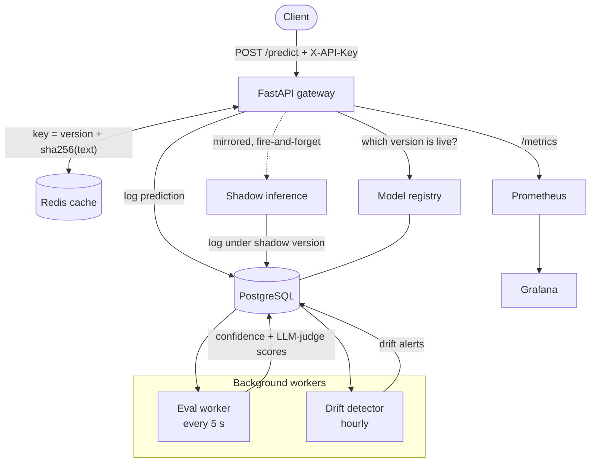
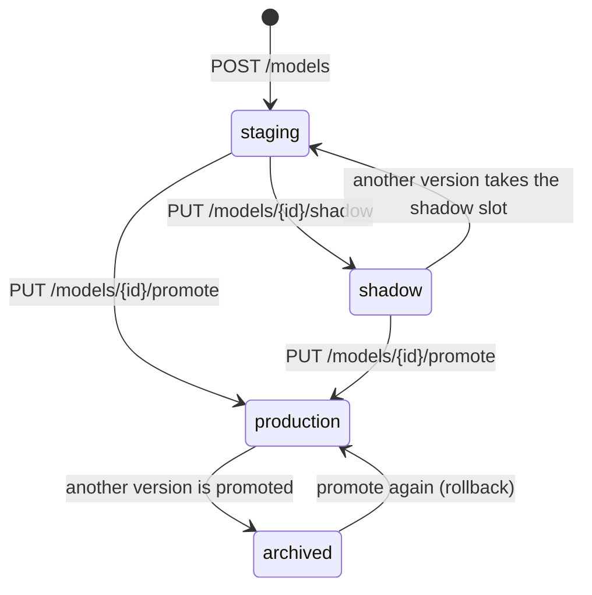

# ML Serving Platform

[](https://github.com/YaseminAkin/ml-serving-platform/actions/workflows/ci.yml)


A production-style serving stack around a HuggingFace sentiment model. It has a versioned model registry with promotion and shadow deployments, a Redis prediction cache, an async evaluation worker (model confidence plus an optional LLM judge), statistical drift detection, and Prometheus + Grafana observability.

The model is deliberately simple (`distilbert-base-uncased-finetuned-sst-2-english`, CPU-friendly). The platform around it is the point.

## Features

- **Model registry** with a `staging → shadow → production → archived` lifecycle, one-call promotion and instant rollback.
- **Shadow deployments**: live traffic is mirrored to a candidate version in the background, so it never changes the response or adds latency.
- **Prediction cache** in Redis, keyed by model version and input hash, so a promotion can never serve stale predictions.
- **Async evaluation**: a separate worker scores every logged prediction, using the model's own confidence and, optionally, an LLM-as-judge.
- **Drift detection**: an hourly job compares each version's recent confidence against its baseline and records alerts.
- **Observability**: Prometheus metrics and a Grafana dashboard provisioned from the repo (dashboard-as-code).
- **Quality gates**: 50 integration tests against real Postgres and Redis, plus ruff, black and mypy, all run in GitHub Actions.

## Architecture



**What happens on `POST /predict`**

1. The API key is checked (`X-API-Key` header).
2. The gateway looks up the current production version in the registry.
3. It checks Redis for `prediction:{version}:{sha256(text)}`. On a hit it returns straight away. On a miss it runs inference and caches the result for an hour.
4. The prediction is logged to Postgres with its latency and cache status.
5. If shadow mode is on and a shadow version is registered, the same input is scored again in a background task and logged under the shadow version. Failures there are logged and swallowed, never raised to the caller.

## Model lifecycle



At most one version can be in production and at most one in shadow at any time. The registry enforces this with row locks, and partial unique indexes in Postgres back it up if two requests race.

## Evaluation and drift

| | Eval worker (`eval/worker.py`) | Drift detector (`eval/drift.py`) |
| --- | --- | --- |
| Runs | Every 5 s, in batches of 20 | Every hour |
| Reads | Predictions without an eval score yet | Confidence scores per model version |
| Does | Writes a **confidence** score for every prediction and, if `OPENAI_API_KEY` is set, an **LLM-judge** score (`gpt-4o-mini`, JSON mode, temperature 0) | Compares the mean of the first 500 scores (baseline) with the latest 500 (rolling) and writes a `drift_alert` when they differ by more than 0.1 |
| On failure | Skips the score and keeps going | Logs and retries next cycle |

`GET /eval/summary` also computes drift live, as `ok`, `warning` (over half the threshold) or `alert`. That way it's never up to an hour stale. Because scoring reads from the database rather than the live request, evaluations can be re-run over historical predictions.

## Observability

| Metric | Type | What it measures |
| --- | --- | --- |
| `request_count` | Counter | Prediction requests, by `model_version` and `status_code` |
| `inference_latency_seconds` | Histogram | Model inference time. Cache hits are excluded, so this measures the model, not Redis |
| `cache_hit_total` | Counter | Prediction cache hits |
| `active_model_version` | Gauge | `1` for the version currently in production, `0` for the others |

The Grafana dashboard (`infra/grafana/dashboard.json`) and its data sources are provisioned automatically. It shows:
- requests per second by model version
- p50, p95 and p99 inference latency
- cache hit rate
- a drift-alert table read straight from Postgres

## API

Interactive docs are served at `/docs`. Endpoints marked 🔑 need the `X-API-Key` header.

| Method | Path | Key | Description |
| --- | --- | :---: | --- |
| `POST` | `/predict` | 🔑 | Classify text and return label, score, model version, cache status and latency |
| `POST` | `/models` | 🔑 | Register a model version (starts in `staging`) |
| `GET` | `/models` | 🔑 | List registered versions, newest first |
| `PUT` | `/models/{id}/shadow` | 🔑 | Make a version the shadow candidate |
| `PUT` | `/models/{id}/promote` | 🔑 | Promote a version to production (the previous one is archived) |
| `GET` | `/eval/summary` | 🔑 | Per-version prediction count, average confidence and live drift status |
| `GET` | `/eval/predictions?version=` | 🔑 | Paginated prediction browser with confidence and LLM-judge scores |
| `GET` | `/alerts` | 🔑 | Drift alert history, newest first |
| `GET` | `/metrics/cache` | | Cache hit rate and totals |
| `GET` | `/metrics` | | Prometheus scrape endpoint |
| `GET` | `/health` | | Liveness check |

```bash
curl -s localhost:8000/predict \
  -H "X-API-Key: dev" -H "Content-Type: application/json" \
  -d '{"text": "The new release is fantastic"}'
```

Example response:

```json
{
  "label": "POSITIVE",
  "score": 0.9998,
  "model_version": "v1",
  "cached": false,
  "latency_ms": 41.7
}
```

<details>
<summary><b>Walkthrough: shadow-test a new version, then promote it</b></summary>

Start the gateway with `SHADOW_ENABLED=true`, then:

```bash
KEY='X-API-Key: dev'
JSON='Content-Type: application/json'

# Register two versions and put v1 live
curl -s -X POST localhost:8000/models -H "$KEY" -H "$JSON" \
  -d '{"name": "sentiment", "version": "v1", "path": "distilbert-base-uncased-finetuned-sst-2-english"}'
curl -s -X POST localhost:8000/models -H "$KEY" -H "$JSON" \
  -d '{"name": "sentiment", "version": "v2", "path": "distilbert-base-uncased-finetuned-sst-2-english"}'
curl -s -X PUT localhost:8000/models/1/promote -H "$KEY"

# Mirror live traffic to v2 without affecting responses
curl -s -X PUT localhost:8000/models/2/shadow -H "$KEY"

# ...send some /predict traffic, then compare the two versions
curl -s localhost:8000/eval/summary -H "$KEY"

# Happy with v2? Promote it. v1 is archived, and promoting v1 again rolls back.
curl -s -X PUT localhost:8000/models/2/promote -H "$KEY"
```

</details>

## Running it locally

You need Python 3.11+ and Docker.

```bash
make install-dev        # package + dev tools + pre-commit hooks
cp .env.example .env    # optional: change settings
docker compose -f infra/docker-compose.yml up -d postgres redis
alembic upgrade head    # create the database schema
```

Then choose one:

- **Full stack in Docker** (gateway, Prometheus, Grafana): `make up`
- **Gateway with hot reload**: `uvicorn gateway.main:app --reload`

Start the background workers in their own terminals:

```bash
python -m eval.worker   # scores new predictions
python -m eval.drift    # hourly drift check
```

| Service | URL |
| --- | --- |
| Gateway + API docs | http://localhost:8000/docs |
| Prometheus | http://localhost:9090 |
| Grafana (anonymous view; admin login `admin` / `admin`) | http://localhost:3000 |

The first build downloads PyTorch, and the gateway downloads the DistilBERT weights the first time it starts, so the initial start takes a few minutes.

### Configuration

All settings come from environment variables, and `.env` is loaded automatically. `.env.example` lists every variable with its default.

| Variable | Default | Purpose |
| --- | --- | --- |
| `DATABASE_URL` | local Compose Postgres | Postgres connection (asyncpg driver) |
| `REDIS_URL` | `redis://localhost:6379` | Redis connection |
| `API_KEY` | `dev` | Key expected in `X-API-Key` |
| `SHADOW_ENABLED` | `false` | Mirror traffic to the shadow version |
| `OPENAI_API_KEY` | not set | Turns on LLM-judge scoring |
| `OPENAI_EVAL_MODEL` | `gpt-4o-mini` | Judge model |
| `EVAL_POLL_INTERVAL_SECONDS` / `EVAL_BATCH_SIZE` | `5` / `20` | Eval worker cadence |
| `DRIFT_CHECK_INTERVAL_SECONDS` | `3600` | Drift check cadence |
| `DRIFT_WINDOW_SIZE` / `DRIFT_THRESHOLD` | `500` / `0.1` | Baseline and rolling window size, and the alert threshold |

## Development

```bash
make lint        # ruff
make format      # black + ruff --fix
make typecheck   # mypy
make test        # pytest (needs Postgres + Redis running)
make test-cov    # pytest with coverage
```

The tests are integration tests. They run against real Postgres and Redis, and wipe tables and the cache between tests. In CI, the lint job runs ruff and black. The test job starts Postgres 16 and Redis 7 as service containers, applies the Alembic migrations and runs the suite with coverage.

## Design decisions

- **Shadow traffic is fire-and-forget.** It uses `asyncio.create_task`, with a strong reference held so the task isn't garbage-collected. The caller never waits for the shadow model or sees its errors.
- **Cache keys include the model version.** Promoting a version can't return predictions cached under the old one. If Redis fails, the request is treated as a cache miss instead of an error.
- **Evaluation runs in its own process.** It stays off the inference path, and stored predictions can be re-scored later with new methods.
- **"One production version" is guaranteed by the database.** Application logic takes row locks, and partial unique indexes on `status` catch concurrent promotions.
- **Drift is computed in SQL.** Windowed `AVG()` subqueries return two numbers per version, instead of pulling hundreds of rows into Python.
- **Dashboards are code.** The Grafana dashboard and data sources are committed as JSON and YAML, so they're reproducible and reviewable.

## Project structure

```text
gateway/        FastAPI app: routers (predict, models, eval), auth, cache, metrics, model wrapper
registry/       Model version lifecycle and shadow mirroring
eval/           Eval worker, scorers (confidence, LLM judge), drift detector
db/             SQLAlchemy models and Alembic migrations
infra/          Dockerfile (multi-stage, non-root), Docker Compose, Prometheus and Grafana config
tests/          Integration tests (pytest + pytest-asyncio)
```

## Roadmap

- Load each registered version's weights from its `path`. Today every version serves the same DistilBERT pipeline, so shadow comparisons exercise the plumbing rather than two different models.
- Run the eval worker and drift detector as Docker Compose services, with migrations applied on startup.
- Add a Grafana screenshot to this README.
